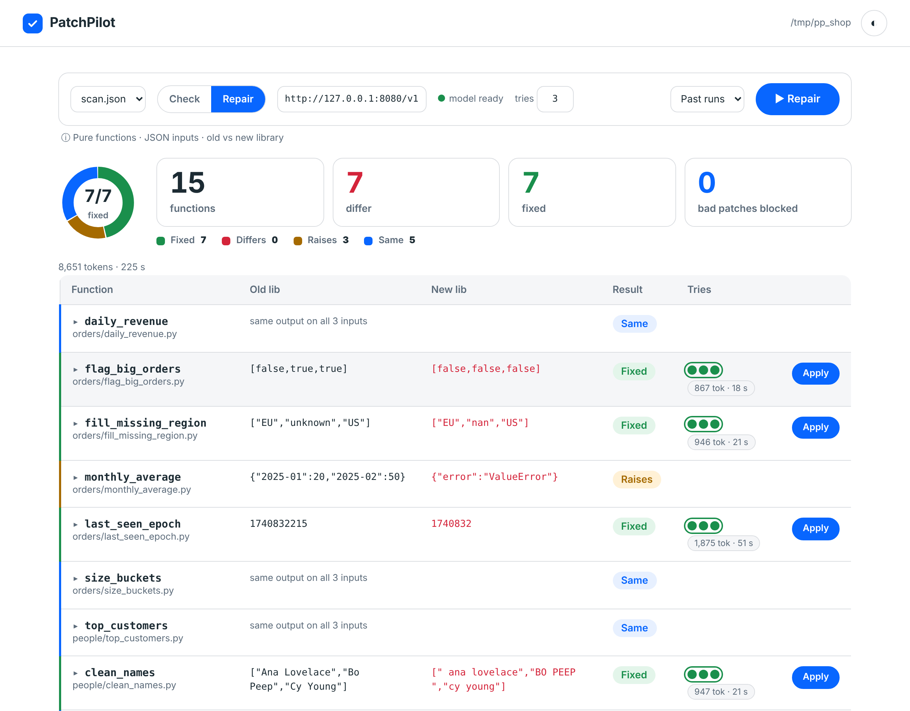

# PatchPilot
Finds Python functions that silently return different results after a library upgrade (pandas 2.3 to 3.0, NumPy 1.26 to 2.x), repairs them with a Meta model, and writes a patch only if three gates agree. A local browser app runs the whole thing; the model can be the open-weight Muse Glimmer on your own machine.



*Recorded run (run 2 of three) on `examples/shop/` (15 functions we wrote): 5 unaffected, 3 fail loudly, 7 differ silently; all 7 repaired on the first attempt with local Muse Glimmer, 8,651 tokens, 225 s (`examples/shop_result_run2/`). The same model failed one of the seven in an earlier run on the same set (`examples/shop_result/`): three runs on this set show variation, not a rate (run 3: 7/7 as well, but three patches were rejected by the gates on the way: `examples/shop_result_run3/`).*

**Try it (no model needed for Check).** Once, build the four pinned library environments (needs Python 3.12 and internet, a few minutes): `PYTHON312=/path/to/python3.12 ./scripts/setup_envs.sh`. Then:

    cd PatchPilot && python -m patchpilot.app --root examples

Open `127.0.0.1:8765`, pick `shop/scan.json`, press **Check**. **Repair** needs a model (see "Models and where they run"). **Apply** writes a patch after a second confirmation and keeps a backup; **Undo** restores it. A single row can be repaired or retried on its own. The page is for functions that are pure, take JSON inputs and behave differently on the old and the new library; `python -m patchpilot.capture` records such inputs from your own tests.

Built during the Meta Global AI Developer Hackathon (Oct 26 - Nov 4, 2026); the first commit of this repository is from Oct 27. The problem: Python code that broke silently after a dependency upgrade, where the tests stay green and the output is wrong.

**At a glance**

- A patch is accepted only if it passes three gates: the visible tests, hidden tests the model never sees, and a differential check against the old library.
- Two sets of functions run through the app, both written by us: the shop set (15 functions, 7 silent breaks; three runs with local Glimmer: 6, 7 and 7 repaired) and the ledger project (22 functions with their own tests, inputs recorded from those tests; local Glimmer and hosted Spark each repaired 7 of 7 on the first attempt; table in `docs/APP_RUNS.md`).
- Seventeen benchmark cases (pandas 2.3 to 3.0, NumPy 1.26 to 2.x), all written for this project: the code under repair is ours, derived from documented library changes. No third-party code is in the repository. Not tried on whole real repositories. What real projects show about the problem is in `docs/IMPACT.md`.
- Hosted Muse Spark and Muse Wonder solved 125 of 125 runs on five cases; on the hardest one (p4), Spark 0 of 5 and Wonder 3 of 5. Muse Glimmer running locally solved 19 of 30 runs on six cases (low reasoning).
- All model runs were made on one Apple M2 Ultra Mac. The Linux isolation layer was tested on one cloud VM without a model run (see "Isolation on Linux").
- Why it matters and what it does not show: [`docs/IMPACT.md`](docs/IMPACT.md). One command from a function to a gated patch: `python -m patchpilot.repair` (see "Try it on your own function").

## What was built during the hackathon

The repository was created on 2026-10-27 (first commit 12:26, UTC+3, after the kickoff) and contains only work from the event: the repair loop and the three gates, the differential input generator, the isolation of model code (macOS profile and a Linux Landlock launcher written with `ctypes`), the case builder and the one-command repair tool, the scan command for a set of functions, the browser app that runs it (Check, Repair, Apply, Undo, Reset, per-row Retry) and the browser view of its report, `capture`, which records inputs from your own tests, a shop set and a small project (`examples/ledger`) to run them on, the benchmark runner, seventeen benchmark cases with their known-good and known-bad patches, and the documentation, logs and technical notes. Not ours and not in the repository: pandas, NumPy and pytest (installed from PyPI into pinned environments; they are the libraries being repaired), llama.cpp (runs the local model), and the Meta models. No code from other projects is included. Track: Indie Developer; problem statement: Push the Frontier (software).

## For judges: three ways to check it

1. **No model, no key:** build the pinned environments once (`PYTHON312=/path/to/python3.12 ./scripts/setup_envs.sh`), then `bash scripts/run_offline_tests.sh` (fourteen tests; about four minutes: the test times add up to 221 s in the latest run on the Mac, twelve tests in 124 to 163 s in three earlier runs). Or read `docs/RESULTS.md` and `examples/` (recorded patches with the gate outcome per attempt) without running anything.
2. **Hosted Meta models:** put a Meta Model API key in the key file described under "Run the agent" and run the agent on a case.
3. **Open weights on your own machine:** serve Muse Glimmer with llama.cpp as described under "How the local model is run" and run `bash scripts/demo_repair.sh`.

## Models and where they run

| model | how it is used | where it runs |
|---|---|---|
| muse-spark-1.3 | hosted, Meta Model API (Chat Completions) | Meta |
| muse-wonder-1.0 | hosted, Meta Model API (Chat Completions) | Meta |
| Muse Glimmer 30B (open weights, Apache 2.0), Q4_K_M GGUF | served locally with llama.cpp (Metal); `--endpoint http://127.0.0.1:8080/v1`; no API key is read or sent and requests only go to a loopback address | the Apple M2 Ultra Mac used for development |

The same gates and the same benchmark runner are used for all three models. The local weights are `meta-models/Muse-Glimmer-30B-GGUF`, file `Muse-Glimmer-30B-KQuant-17GB-Q4_K_M.gguf`, 16756683904 bytes, sha256 `4cc57c0f51040a226e5a72cc47b7613f7772950e460a665f7083de89f183f60e`; llama.cpp 0.8.0 (build 11960, commit 8642541b2). The result files record the server build and the model file name. The commands below follow the Muse Glimmer documentation and were run on this machine only:

    brew install llama.cpp
    hf download meta-models/Muse-Glimmer-30B-GGUF --local-dir ~/models/muse-glimmer --include "Muse-Glimmer-30B-KQuant-17GB-Q4_K_M.gguf"
    llama-server -m ~/models/muse-glimmer/Muse-Glimmer-30B-KQuant-17GB-Q4_K_M.gguf -a muse-glimmer -ngl 99 -c 65536 -np 1 --host 127.0.0.1 --port 8080 --chat-template-kwargs '{"reasoning_strength":"low"}'
    python -m patchpilot.bench --endpoint http://127.0.0.1:8080/v1 --cases n6_uint8_scaling --effort low --repeats 5 --score-seed 1

## Third-party software and models
PatchPilot's own code (`patchpilot/`, `scripts/`) imports only the Python standard library, with one optional exception: `patchpilot/ui_smoke.py`, a browser check of the app page, imports Playwright if it is installed and skips itself if not. What it uses from others, all unmodified and under their own licenses:

| component | role | license |
|---|---|---|
| pandas 2.3 and 3.0 | the library under repair; installed only in the sandbox environments, never imported by PatchPilot | BSD 3-Clause |
| NumPy 1.26 and 2.x | the library under repair; same | BSD 3-Clause |
| llama.cpp | serves the local open-weight model | MIT |
| Playwright (optional) | only for `python -m patchpilot.ui_smoke`, a browser check of the app page; nothing else needs it | Apache 2.0 |
| Muse Spark 1.3 and Muse Wonder 1.0 | Meta Model API, called at runtime | Meta's API terms |
| Muse Glimmer 30B (GGUF) | Meta open-weight model, served locally | Apache 2.0, as listed on its model page |

Every model the repair loop calls is a Meta model. No third-party source code is copied into the repository.

## How it works
For each case the agent receives the program source, the golden output (from the old library) and the actual output on the new library, and proposes a patch. By default this is one model call per attempt with a JSON reply and no tool use; `--tools` mode (see below) adds a tool conversation per attempt. A rejected attempt returns feedback to the model. A patch is accepted only if all three gates pass:

1. **Visible check:** the recorded inputs reproduce the golden output (generated with the OLD library).
2. **Hidden check:** held-out inputs that are never shown to the model.
3. **Differential check:** generated inputs run through the original code on the old library and the patched code on both libraries; core divergences reject the patch.

Defaults: up to 3 attempts per run, 60000 token budget (checked before each model call, so a run can exceed it by one call). The benchmark runner can switch the differential gate off (`--no-differential`) and score accepted patches with it afterwards at another seed (`--score-seed`).

## Isolation of model code

Patched code runs in a subprocess inside a temporary copy of the case (`patchpilot/sandbox.py`) with a wall-clock timeout (the process group is killed), a CPU-time limit and a minimal environment without inherited secrets. Model code runs on your machine with your user's privileges; this runner is not a hardened security boundary. On macOS, `bench` and `agent` additionally wrap model code in `sandbox-exec` (no read or write access to the home directory and the repository except the sandbox environments, no network), re-exec themselves with a minimal environment, read the API key from a file instead of the environment, and refuse to run model code if the harness environment holds secret-looking variables or the isolation self-test fails. Shown on one macOS machine with fake secrets (`patchpilot/isolation_test.py`, `patchpilot/negative_test.py`, details in the engineering log): a fake secret file under `~/.config`, the repository's `hidden_golden.json` (absolute path), a home directory listing and a loopback connection were blocked. Reading the harness's initial environment through `sysctl` was NOT blocked by the profile, which is why the environment must not hold secrets. Not tested: memory inspection tools (`lldb`, `vmmap`, `gcore`), other same-user processes that hold secrets, external network. On Linux the same entry points use Landlock (see "Isolation on Linux" below). On other platforms `bench` and `agent` are written to refuse to run unless `--no-fs-deny` is given (only the missing `sandbox-exec` case was tested); such runs are marked `fs_deny=false` and are not counted. There is no memory limit. With the key file present, `bench` and `agent` refuse `--no-fs-deny` (checked once each; the check lives in the argument handling).

### Isolation on Linux

`patchpilot/sandbox.py` starts model code through `patchpilot/landlock_exec.py`, a launcher written with `ctypes` and the standard library only (no packages). Landlock needs no privileges. It is an allow list: the process can read the interpreter, system libraries and its own sandbox environment, can read and write only its temporary workspace, and can neither read the home directory or the repository (including `hidden_golden.json`) nor bind or connect TCP ports (kernel Landlock ABI 4 or later). With ABI 6 or later it also cannot signal the harness. The launcher additionally tries to move the process into an empty network namespace, which is what blocks UDP; if the kernel refuses, it continues with Landlock only. If Landlock is unavailable the launcher exits with code 126 and nothing runs unisolated. The self-test of the macOS layer runs here too, before the first model code.

Shown on one Linux cloud VM (kernel 6.18.44, Landlock ABI 7, Python 3.13.18 for the harness), as root and as an unprivileged user: `patchpilot/landlock_test.py` (14 checks, fake secrets, a control run with isolation off in which every action succeeds) passed. Blocked: a fake secret file in the home directory, a repository file, a home directory listing, a write to the home directory, a TCP connection to the harness, reading the harness's `/proc/<pid>/environ`, a symlink pointing to the secret, signalling the harness, UDP (network namespace active). Allowed: the temporary workspace and importing pandas and NumPy. With Landlock alone, without the network namespace, UDP was NOT blocked (printed by the test). All eight offline tests that `scripts/run_offline_tests.sh` had then also passed on that VM (about 2 minutes there). Not tested: other kernels, containers whose seccomp profile blocks the Landlock system calls (the launcher would then refuse to run), distributions other than the one on that VM, an actual model run on Linux.

## Without running anything

The numbers and patches behind the results can be read without running the benchmark:

- [`docs/RESULTS.md`](docs/RESULTS.md): one row per case and result file in `results/`, generated by `scripts/make_showcase.py`. It lists every file, including the 1-run smoke tests.
- [`examples/`](examples/): fourteen patches written by the models in recorded runs, chosen to show the cases and the gates (not a random sample). Each has the gate outcome per attempt and the model's own diagnosis; where the differential rejected an attempt, the counterexample that was returned to the model. One example is a patch that was accepted with the differential gate off and failed the differential afterwards. "Accepted" means the patch passed the gates that were on in that run; no review beyond the gates is claimed.
- [`docs/engineering-log.md`](docs/engineering-log.md) and [`docs/training-notes.jsonl`](docs/training-notes.jsonl): what was measured, what failed and what was not tested.

## Platform

All recorded model runs were made on one Apple Silicon Mac (Apple M2 Ultra, macOS 26.6.2). The isolation layer uses `sandbox-exec` on macOS and Landlock on Linux. On one Linux cloud VM (see "Isolation on Linux") `setup_envs.sh` built the four environments, all 16 cases that existed then were valid, and `scripts/run_offline_tests.sh` passed without a `.venv` (it falls back to `python3`); no model was run there.

## Setup
Requires Python 3.12 (tested with 3.12.16). `PYTHON312` must point to a Python 3.12 interpreter; on the macOS machine used for development `python3.12` was not on `PATH`, so the path was passed explicitly. A fresh clone with this script built the four environments and reported all six cases valid (six cases at that time; p5, p6 and n8 were added later and validated in the same environments). One command builds four pinned virtual environments under `.sandboxes/` and validates all cases:

    PYTHON312=/path/to/python3.12 ./scripts/setup_envs.sh

A case is valid only if the old library is OK, the new one silently breaks, tests are green on both, hidden inputs break too, the known-good patch is accepted and the known-bad patches are rejected. Validation of a single case:

    python -m patchpilot.validate_case benchmarks/p1_epoch_seconds

## Run the agent
The runner (`patchpilot/*.py`) imports only the Python standard library, including `urllib` for the model API; pandas and NumPy are needed only inside the four sandbox environments.

    # one-time, from your own terminal: the key is typed hidden and goes only into this file
    ( umask 077; mkdir -p ~/.config/patchpilot && chmod 700 ~/.config/patchpilot; printf 'Meta API key: '; stty -echo; read -r K; stty echo; echo; printf '%s\n' "$K" > ~/.config/patchpilot/meta_key; chmod 600 ~/.config/patchpilot/meta_key; unset K )
    python -m patchpilot.meta_client keycheck   # prints the file mode and the key length, never the key
    python -m patchpilot.agent benchmarks/p1_epoch_seconds .sandboxes/pd23/bin/python .sandboxes/pd30/bin/python

Cases n6/n7 use `.sandboxes/np126` and `.sandboxes/np2`. Benchmark runner: `python -m patchpilot.bench --help`.

## Try it on your own function

`patchpilot.make_case` builds a case folder from one function in one file. You give it the file, the function name, a JSON list of keyword-argument inputs, and two interpreters (old and new library version):

```
python -m patchpilot.make_case --src my_module.py --fn my_function --inputs probes.json \
    --old /path/to/old/python --new /path/to/new/python --lib pandas --out my_case
python -m patchpilot.agent my_case /path/to/old/python /path/to/new/python --lib pandas
```

The same two steps as one command, `patchpilot.repair`: it builds the case in a temporary folder, repairs it behind the three gates, writes the accepted patch as a diff plus a JSON report, and changes your file only with `--apply` (and only if the file is unchanged since the case was built):

```
python -m patchpilot.repair my_module.py my_function --inputs probes.json --lib pandas \
    --endpoint http://127.0.0.1:8080/v1 [--apply]
```

Default interpreters are `.sandboxes/pd23` and `.sandboxes/pd30` for pandas, `np126` and `np2` for numpy (override with `--old` and `--new`). Exit code 0 means a patch passed the gates, 1 means none did, 2 means the case could not be built. "Accepted" means it passed the gates that were on; read the diff before you use it. On `examples/own_function/subject_dropout.py` (`bash scripts/demo_repair.sh`, local Glimmer, effort low) three runs were each accepted on the first attempt: 2025, 2013 and 2072 tokens, 32, 34 and 31 s for the repair on our Mac (the last run took 35 s for the whole command, case build included, server already loaded), differential PASS with 138 valid of 200 generated inputs and 0 divergences each time, and the patch replaced the chained write with `table.loc[position, "observed"] = 0` (once with an added comment line); that is three runs, not a rate (the function is also benchmark case o3, 15 of 15 solved). `python -m patchpilot.repair_test` checks the command offline with a scripted model reply (accepted, rejected, unknown function, `--apply`, changed file).

The golden output comes from the old interpreter. Held-out inputs are derived with the differential generator and kept only if the old library reproduces them (or pass `--hidden-inputs`). It stops with a reason if the function raises on the old library, is not deterministic, crashes on the new library (a loud failure) or gives the same output there (nothing to repair).

Limits: the function must live in one self-contained file (standard library plus the library under repair), take JSON-friendly arguments and return JSON-friendly values, or take and return pandas DataFrames in the `$df` form below (otherwise write a small adapter in the same file), and be deterministic. No known-good or known-bad patches are generated. `python -m patchpilot.make_case_test` checks the builder offline on three existing functions.

Example in `examples/own_function/`: `subject_dropout.py`, a function we wrote that marks a share of subjects as dropped out with a chained assignment (the write is lost on pandas 3). The same function is the benchmark case `o3_subject_dropout`, where muse-glimmer (local, effort low) solved 15 of 15 runs, 15 on the first attempt (see "Results on o1, o2 and o3"); `bash scripts/demo_own_function.sh` builds a case from it and repairs it, `bash scripts/demo_repair.sh` runs the one-command tool on a copy. A run with muse-spark-1.3 on the `n8` function rebuilt with `make_case` solved on the first attempt (3350 tokens); that was a single run, not a success rate. `bash scripts/run_offline_tests.sh` runs the fourteen offline tests (no model call, no real key; `landlock_test` skips itself on macOS; timings on the Mac are in the engineering log).

## Check a set of functions: scan
`python -m patchpilot.scan scan.json` takes a list of functions with their inputs (a manifest; paths are relative to it) and runs each one on the old and on the new library. Each function ends up as `healthy` (same output), `silent` (the output differs and nothing is raised: it is repaired behind the same three gates), `loud` (the new library raises: reported, not repaired, because it is not a silent break) or `invalid`. One `scan_report.json` and one diff per repaired function are written; files change only with `--apply`. It does not find functions or inputs by itself: you list them.

`examples/sample_repo/` holds eight functions we wrote for this (five break silently on pandas 3 or NumPy 2, two are unaffected, one fails loudly). `bash scripts/demo_scan.sh` runs the scan on a copy with the local Glimmer server; `python -m patchpilot.scan examples/sample_repo/scan.json --triage-only` classifies them without any model call. One run on our Mac with the local Glimmer (effort low, `bash scripts/demo_scan.sh`, 183 s for the whole command, 7812 tokens; `examples/scan_result/` has the report and the accepted diffs): the two unaffected functions were classified `healthy`, the loud one `loud`, and of the five silent breaks four were repaired on the first attempt (1049, 896, 1007 and 936 tokens; 26.2, 18.6, 20.8 and 17.0 s) and one, `total_with_tax`, was not: in three attempts (3924 tokens, 83.1 s) the model forced both libraries to float32, while the old behavior is float64, and the gates rejected all three, so nothing was written. That is one run, not a rate. `python -m patchpilot.scan_test` checks the command offline with scripted replies: the five silent breaks are repaired and applied, the three other files stay untouched, a reply that fixes nothing is rejected, a bad manifest exits with code 2.

## A larger set: a shop code base
`examples/shop/` has 15 functions (orders, people, metrics) that we wrote the way such code is usually written; we did not choose which ones break, the scan did. Check, no model: 5 unaffected, 3 fail loudly (`monthly_average`, `p90_latency`, `area_under`), 7 differ silently. The classification is the same on the Linux VM and on the Mac. Repair with the local Glimmer (effort low, started from the app; three runs on the same set; `examples/shop_result/`, `examples/shop_result_run2/` and `examples/shop_result_run3/` hold the reports and the accepted diffs). Run 1 (334 s, 13,097 tokens): six of the seven silent breaks were repaired on the first attempt (850, 955, 1168, 1191, 917 and 1003 tokens; 13 to 29 s each) and `discounted_price` was not: a float32 price times a Python float, the same kind of function as `total_with_tax` in the sample repository, where Glimmer also failed; three attempts (7013 tokens, 179 s) were rejected by the gates and nothing was written. Run 2 (225 s, 8,651 tokens, a fresh copy of the folder): all seven were repaired on the first attempt (867, 946, 1875, 947, 984, 904 and 2128 tokens; 14 to 57 s each), `discounted_price` included. Run 3 (327 s, 13,117 tokens, a fresh copy): all seven repaired; five on the first attempt (870, 1104, 1161, 949 and 944 tokens), `last_seen_epoch` on the second (the first patch was rejected at the visible tests; 2917 tokens, 72 s) and `discounted_price` on the third (the first was rejected at the hidden tests, the second at the visible tests; 5172 tokens, 125 s): three patches were blocked by the gates and the retries then passed all three. The same model on the same function failed once (run 1), passed at once (run 2) and passed on the third try (run 3): three runs show variation, not a rate. We know the pandas 3 and NumPy 2 changes, so 7 silent breaks out of 15 is a higher share than ordinary code would give; this is a set we wrote, not independent evidence. Preparing this set exposed a bug in the input generator (a field that is an int in one input and a float in another made it crash); it is fixed and `gen2_test` covers it.

## App (run it in the browser)
`python -m patchpilot.app --root examples` opens `127.0.0.1:8765` (standard library only). Pick a `scan.json` found under the folder, press **Check** (old against new library, no model) or **Repair** (local model, or a hosted Meta model when a key file exists). The table fills as the scan runs: result per function, the three gates per try as dots, **Stop**, and **Apply** (asks once more, keeps a copy of the original, then writes the patch), **Undo** (puts the original back, only if the file is still exactly what Apply wrote) and per-row **Repair** / **Retry** (runs one function only, `scan --only`). The row being repaired opens by itself and scrolls into view (a Working panel first, then the three gates and the patch when the model's attempt is ready), until you open a row yourself. **Auto-apply** presses Apply for each fixed function with a short animation and **Auto-write** also confirms and writes it (both off by default; Auto-write needs Auto-apply). **Reset** puts every file the app wrote back to its first content (the first version of each file is saved in `.patchpilot/baseline/`); it leaves a file alone that was edited by hand since the app wrote it and is refused while a run is in progress. After a write, Check shows the function as unchanged until you Reset. Past runs are kept in `.patchpilot/` inside the folder and can be opened again.
Safety: loopback only; each API call needs the random token that was put into the page and a matching Host and Origin; only manifests below `--root` run; the model address must be a loopback address; one job at a time; the page never reads or sends the API key; Apply writes only if the file still has the exact content (sha-256) the scan read and the accepted patch touches only that file. `python -m patchpilot.ui_smoke` (optional, needs Playwright and Chromium, not one of the fourteen offline tests) clicks through the page with a scripted runner: Repair, Auto-apply, a manual write, Reset, Auto-write and the row that opens by itself (12 checks). `python -m patchpilot.app_test` checks all of this offline (46 checks).

## Record inputs from your own tests: capture
`python -m patchpilot.capture --python OLD_PYTHON --target orders/mod.py:total --out probes --manifest scan.json --lib pandas -- -m unittest discover tests` runs your tests or script once on the OLD library and records the arguments of every call to the listed functions (a profile hook; standard library only). Only calls whose arguments are plain JSON values are kept; equal calls once, at most `--limit` per function; functions with `*args`, `**kwargs` or positional-only parameters are skipped. The result is a list of inputs per function and an entry in the scan manifest, so the manifest does not have to be written by hand. It runs your code with your normal permissions (it is not isolated, like any run of your own tests). `--discover FILE_OR_FOLDER` takes every public top-level function of a file or folder as a target, so you do not list them. `python -m patchpilot.capture_test` (14 checks) records calls from a test run and feeds them into a scan that finds the silent break, and does the same for a whole small project (`examples/ledger/`, below). Not tried on third-party code.

## A small project from tests to report: ledger
`examples/ledger/` is a small expense-tracking package we wrote for this (four modules, 22 public functions, a 21-test `unittest` suite that passes on both pandas 2.3 and 3.0). No manifest was written by hand: `python -m patchpilot.capture --python .sandboxes/pd23/bin/python --discover ledger/clean.py --discover ledger/report.py --discover ledger/export.py --out probes --manifest scan.json --lib pandas --cwd examples/ledger -- -m unittest discover -s tests` (and one more run with `--discover ledger/stats.py --lib numpy`) took the inputs from the tests: 2 distinct calls for each of 21 functions; `round_half` was never called by the tests, so it has no inputs and is not in the manifest (a gap in our tests that capture reports). Check, no model, on the Linux VM: 14 same, 7 silent: `fill_categories` (inplace fillna on a column), `drop_dupes` and `label_rows` (a missing value comes back as NaN instead of None), `flag_large` (chained assignment), `epoch_seconds` (datetime resolution: 1767225 instead of 1767225600), `range_text` (printed `np.float64(...)`), `add_bonus` (`np.uint8(200) + 100` is 300 on NumPy 1.26 and 44 on NumPy 2). We wrote the functions in ordinary style and the scan decided which break; we still know the library changes, and the project is ours, so this shows the pipeline on a project with its own tests, not how often real code breaks. Repair with the local Glimmer (effort low, started from the app, `examples/ledger_result/` holds the report and the accepted diffs): all seven were repaired on the first attempt and passed all three gates (1037, 1792, 1151, 2917, 1396, 1328 and 2926 tokens; 24 to 81 s each; 338 s and 12,547 tokens for the whole run, Check included). One run, not a rate. The same set with the hosted muse-spark-1.3, started from the app (`examples/ledger_result_spark/`): all seven repaired on the first attempt, all gates passed (1882, 3263, 2382, 3441, 4004, 1845 and 2559 tokens; 10 to 27 s each; 167 s and 19,376 tokens for the whole run, Check included); the first hosted run through the app, also one run. Whether a patch is the best fix was not judged beyond the three gates.

## How common is the problem, and a CI gate

`docs/CENSUS.md`: a static count of three pandas-3 patterns in 16 libraries and 7 teaching repositories, with the list fixed before counting and every hit read. 0 real hits in the libraries, 5 in the teaching notebooks; a count of patterns, not of broken programs, and a small sample. `python scripts/census.py DIR` repeats it.

`python -m patchpilot.scan scan.json --triage-only --fail-on-silent` exits 1 when a listed function still changes silently on the new library (no model, no key); `docs/ci-example.yml` is an example workflow, not active and not run on GitHub.

## DataFrames as input and output: frames

Real pandas code takes tables. An input written as `{"df": {"$df": {"age": [30.0, null, 41.0], "name": ["a", "b", "c"]}}}` is rebuilt as a DataFrame before the call, and a DataFrame or Series result is compared as its column lists and index. Inputs without `$df` run exactly as before (earlier cases and recorded runs are unchanged). `capture` records DataFrame arguments in this form (at most 200 rows, string column names, default index; missing values as null; other frames are skipped, not altered). The generated hidden inputs change tables row-wise, so a table stays a table.

`examples/frames/` is a notebook-style module we wrote (`frames/prep.py`, six functions taking and returning DataFrames; the patterns are the ones counted in `docs/CENSUS.md`). `python -m patchpilot.capture --python .sandboxes/pd23/bin/python --discover frames/prep.py --out probes --manifest scan.json --lib pandas --cwd examples/frames -- -m unittest discover tests` built its manifest and inputs from the project's own six tests. On pandas 2.3.3 → 3.0.6, `scan --triage-only` classifies three as silent (`fillna(..., inplace=True)` on a column, a chained `df["c"][mask] = 1`, a datetime converted to int64) and three as healthy. `python -m patchpilot.frames_test` (8 checks, scripted replies, no model) repairs the three behind the gates.

Limits: results are compared by values, column names and index, not by dtype, so a change that only alters a dtype (for example object to the new string type) is not detected; one table per call shape (a function that takes a file path, a database or an object is outside the scope). One run through the app with the local Glimmer (effort low, 3 tries allowed) repaired all three on the first attempt: 7,182 tokens and 149 s for the whole scan, Check included (`examples/frames_result/`, row in `docs/APP_RUNS.md`); a second run repaired all three too, with one wrong patch blocked by the visible tests on `add_signup_seconds` (10,733 tokens, 204 s, `examples/frames_result_run2/`). Two runs on three functions we wrote, not a rate.

## Browser view (read-only)
`python -m patchpilot.view scan_out/scan_report.json` serves a page on `127.0.0.1:8765` (standard library `http.server`, no framework, no network access, nothing written) that shows, per function, what changed with the upgrade, each attempt going through the three gates, the counterexample that was returned to the model, and the accepted patch. The report carries the gate outcome of every attempt, so `python -m patchpilot.view examples/scan_result/scan_report.json` shows the recorded run (the repaired functions and the three attempts on `total_with_tax` that the first check rejected) without any model or `runs/` folder. The page opens with the counts (functions checked, silently wrong, repaired and verified, wrong patches blocked), then one row per function with the old and the new library output; a click opens the attempts and the patch. `python -m patchpilot.view --run runs/<run folder>` shows one recorded run the same way. `python -m patchpilot.view_test` checks the gate logic and the server offline.

## Limitations
Scope: pure functions whose inputs are JSON values or small pandas DataFrames (not other objects, files or databases), Python on macOS or Linux (Windows unsupported), one library pair per manifest, and the manifest lists the functions (capture helps, nothing finds them by itself). Undo, Reset, Auto-apply/Auto-write and per-row Repair/Retry were tested offline and in a browser with a scripted runner; the hosted-model path of the app was run once for real (ledger, muse-spark-1.3).
All seventeen cases, the shop set and the ledger project are small programs we wrote, derived from documented library changes; PatchPilot has not been tried on whole real repositories or on code from other projects (earlier versions of this repository contained functions copied from three open-source projects; they were removed, see the engineering log). Sample sizes in `results/` are small (1 to 5 runs per case and setting; the first three files have 3 runs per case, one smoke test has 1), so they show direction only. Only token counts were recorded, no dollar cost per run. The first two bench files and earlier runs ran without the differential gate (see the engineering log).
Not tested or not measured: dollar cost and run time of hosted calls (not recorded), Linux beyond one cloud VM and Windows, memory inspection tools (`lldb`, `vmmap`, `gcore`), other same-user processes that hold secrets, external network, whole real open-source repositories and code from other projects, Muse Spark Open and other open-weight models, other quantizations of Muse Glimmer, reasoning levels of Glimmer other than low and medium (medium on four cases only), hosted effort levels other than low (one minimal-effort batch), a tools run with a larger token budget and tools mode with a local endpoint.

Engineering log and technical notes: [`docs/engineering-log.md`](docs/engineering-log.md), [`docs/training-notes.jsonl`](docs/training-notes.jsonl).

## Results so far

All numbers come from the files in `results/`. Cases are synthetic, samples are small, only token counts were recorded. The rows of the first table below were produced before the isolation layer existed: model code ran without the OS layer and the API key was in the process environment (none of the files in that table has an `fs_deny` field). A scan of the 126 saved patches found only imports of pandas, numpy, collections and math, so no sign of file or environment access was found; the scan cannot rule it out.

| setting | model | result | file |
|---|---|---|---|
| effort=minimal, differential gate on, 5 runs per case | muse-spark-1.3 | solved 25/30 runs: n6 5/5, n7 5/5, p1 5/5, p2 5/5, p3 5/5, p4 0/5 | `bench_20261027-185732_muse-spark-1.3.json` |
| p4 only, effort=low, gate on, 5 runs | muse-spark-1.3 | 0/5 | `bench_20261027-190705_muse-spark-1.3.json` |
| p4 only, effort=low, gate on, 5 runs | muse-wonder-1.0 | 1/5 | `bench_20261027-191341_muse-wonder-1.0.json` |
| p4 only, effort=low, gate off, accepted patches scored with the differential at seed 1 | muse-spark-1.3 | 2/5 accepted, 0 pass the differential | `bench_20261027-204730_muse-spark-1.3.json` |
| p4 only, effort=low, gate off, accepted patches scored with the differential at seed 1 | muse-wonder-1.0 | 3/5 accepted, 1 passes the differential | `bench_20261027-205730_muse-wonder-1.0.json` |

Observed in two wonder-1.0 runs (n=2; one before and one after the isolation layer): with the gate on, the differential rejected an attempt that had passed the visible and hidden checks, the counterexample was returned to the model and the next attempt passed. p4 is mostly unsolved; with the gate off, 4 of the 5 accepted patches failed the differential, which is why accepted counts and differential-scored counts are reported separately. Details and caveats: the engineering log.

## Results under the isolation layer: p4

p4_label_histogram only, effort=low, 5 runs per model, differential used as a gate and accepted patches re-scored with the differential at another seed, one invocation per model (the result files have counted=true and fs_deny=true).

| model | solved | first try | accepted patches passing the re-scored differential | avg tokens | file |
|---|---|---|---|---|---|
| muse-spark-1.3 | 0/5 | 0 | 0 | 21230 | `bench_20261027-224719_muse-spark-1.3.json` |
| muse-wonder-1.0 | 3/5 | 1 | 3 of 3 | 13066 | `bench_20261027-225746_muse-wonder-1.0.json` |

First failing gate per attempt: spark-1.3 (15 attempts) visible 7, hidden 6, differential 2; wonder-1.0 (13 attempts) visible 6, hidden 3, differential 1, accepted 3. n=5 per model, one synthetic case; these runs differ from the earlier p4 rows, so this is not a controlled comparison. Only token counts were recorded.

## Results under the isolation layer: the other five cases

effort=low, 5 runs per case in each batch, one-shot protocol (no tools), differential used as a gate, accepted patches re-scored with the differential at another seed; every row has counted=true and fs_deny=true. muse-spark-1.3 was run 4 times with the same command, so all 4 of its batches are listed; muse-wonder-1.0 was run once. The cases are synthetic.

| batch (file in `results/`) | model | runs | solved | first try | re-scored differential pass | avg tokens per run | total tokens |
|---|---|---|---|---|---|---|---|
| `bench_20261028-174452_muse-wonder-1.0.json` | muse-wonder-1.0 | 25 | 25 | 22 | 25 | 2832 | 70797 |
| `bench_20261028-102955_muse-spark-1.3.json` | muse-spark-1.3 | 25 | 25 | 22 | 25 | 3440 | 85994 |
| `bench_20261028-173617_muse-spark-1.3.json` | muse-spark-1.3 | 25 | 25 | 24 | 25 | 3122 | 78048 |
| `bench_20261028-180119_muse-spark-1.3.json` | muse-spark-1.3 | 25 | 25 | 22 | 25 | 3221 | 80536 |
| `bench_20261028-181000_muse-spark-1.3.json` | muse-spark-1.3 | 25 | 25 | 22 | 25 | 3565 | 89137 |

Per case (solved / first try / average tokens per run):

| case | wonder-1.0 | spark-1.3 batch 1 | spark-1.3 batch 2 | spark-1.3 batch 3 | spark-1.3 batch 4 |
|---|---|---|---|---|---|
| n6_uint8_scaling | 5/5 / 5 / 1205 | 5/5 / 5 / 1789 | 5/5 / 5 / 2114 | 5/5 / 5 / 2081 | 5/5 / 5 / 1930 |
| n7_float32_scalars | 5/5 / 5 / 2436 | 5/5 / 5 / 3852 | 5/5 / 5 / 3753 | 5/5 / 3 / 4917 | 5/5 / 4 / 4493 |
| p1_epoch_seconds | 5/5 / 4 / 4660 | 5/5 / 4 / 4365 | 5/5 / 4 / 4179 | 5/5 / 5 / 3436 | 5/5 / 4 / 3984 |
| p2_dst_day_offset | 5/5 / 3 / 3787 | 5/5 / 4 / 4115 | 5/5 / 5 / 2934 | 5/5 / 5 / 3018 | 5/5 / 4 / 5139 |
| p3_groupby_report | 5/5 / 5 / 2071 | 5/5 / 4 / 3078 | 5/5 / 5 / 2629 | 5/5 / 4 / 2655 | 5/5 / 5 / 2281 |

125 of 125 runs were solved and 125 of 125 accepted patches passed the re-scored differential; 13 runs needed more than one attempt. These five cases were solved in every run, unlike p4 (see above). The spark batches differ from each other in first-try counts and token averages, which shows the run-to-run variation at n=5; no comparison between the models is drawn from these rows. Only token counts were recorded.

## How the local model is run

The Glimmer runs in this repository use a model served on the same machine, not a hosted API. The agent is pointed at it with `--endpoint http://127.0.0.1:8080/v1` (the endpoint of every run is stored in its `attempt_N.json` under `endpoint`).

- Hardware: Apple M2 Ultra, 192 GiB RAM, macOS 26.6.2
- Server: llama.cpp `version: 0.8.0 (build 11960, commit 8642541b2)`, AppleClang 21.0.0
- Weights: `Muse-Glimmer-30B-KQuant-17GB-Q4_K_M.gguf`, 16756683904 bytes, sha256 `4cc57c0f51040a226e5a72cc47b7613f7772950e460a665f7083de89f183f60e`
- Source: https://huggingface.co/meta-models/Muse-Glimmer-30B-GGUF, revision `b44f1072cf75e918a1b82a3a17b45c4389b076e7` (recorded in the Hugging Face download metadata next to the file; the hash recorded there equals the sha256 above). The model page lists the license as apache-2.0.
- Client: Python 3.12.16

Start the server:

    llama-server -m ~/models/muse-glimmer/Muse-Glimmer-30B-KQuant-17GB-Q4_K_M.gguf -a muse-glimmer -ngl 99 -c 65536 -np 1 --host 127.0.0.1 --port 8080 --chat-template-kwargs '{"reasoning_strength":"low"}'

Check the file and the server, then run one case:

    shasum -a 256 ~/models/muse-glimmer/Muse-Glimmer-30B-KQuant-17GB-Q4_K_M.gguf
    curl -s http://127.0.0.1:8080/v1/models
    .venv/bin/python -m patchpilot.agent benchmarks/o3_subject_dropout .sandboxes/pd23/bin/python .sandboxes/pd30/bin/python --lib pandas --model muse-glimmer --effort low --endpoint http://127.0.0.1:8080/v1

## Results with a local open-weight model (Muse Glimmer)

Muse Glimmer 30B (Q4_K_M, llama.cpp b11960, one Apple M2 Ultra Mac). One-shot protocol, differential used as a gate, accepted patches re-scored at another seed, at most 3 attempts, 5 runs per case in one batch per case; every row has counted=true and fs_deny=true. `reasoning_strength` was low through the chat template, which is not the same mechanism as `reasoning_effort=low` on the hosted API. No API key is used and the API cost is zero (electricity is not counted).

| case | solved | first try | re-scored differential pass | avg tokens per run | rejected attempts: visible / hidden / differential | wall clock of the 5-run batch (from start times) | file |
|---|---|---|---|---|---|---|---|
| n6_uint8_scaling | 5/5 | 5 | 5 | 1187 | 0 / 0 / 0 | about 2 min 39 s | `bench_20261028-210347_muse-glimmer_local.json` |
| n7_float32_scalars | 2/5 | 1 | 2 | 5047 | 11 / 0 / 0 | about 9 min 47 s | `bench_20261028-210626_muse-glimmer_local.json` |
| p1_epoch_seconds | 3/5 | 2 | 3 | 2825 | 3 / 0 / 4 | about 5 min 41 s | `bench_20261028-211613_muse-glimmer_local.json` |
| p2_dst_day_offset | 4/5 | 3 | 4 | 5060 | 4 / 0 / 0 | about 9 min 4 s | `bench_20261028-212154_muse-glimmer_local.json` |
| p3_groupby_report | 5/5 | 4 | 5 | 2755 | 2 / 0 / 0 | about 4 min 56 s | `bench_20261028-213058_muse-glimmer_local.json` |
| p4_label_histogram | 0/5 | 0 | 0 | 6604 | 9 / 6 / 0 | not recorded | `bench_20261028-213554_muse-glimmer_local.json` |

19 of 30 runs were solved, 15 on the first attempt, and 19 accepted patches passed the re-scored differential. Of the 58 attempts, 39 were rejected: 29 at the visible check, 6 at the hidden check and 4 at the differential. The longest completion was 2389 tokens (cap 12000) and 0 replies were empty, so the unsolved runs are gate rejections, not truncation, as far as the recorded attempts show. In the three requests of the server log excerpt that was inspected, generation ran at 24.1 to 26.4 tokens per second. For context: the hosted models solved 125 of 125 runs on the five cases other than p4 and, on p4 (one-shot, isolation layer), spark-1.3 0 of 5 and wonder-1.0 3 of 5; Glimmer solved 19 of 25 on the five cases and 0 of 5 on p4. These are different models with different quantization and reasoning mechanisms, one batch per case: no claim is made about the reasons. Token counts include the reasoning trace; the usage object does not report reasoning tokens separately.

### Glimmer at reasoning strength medium (four cases)

Same server, same protocol and same case files, with `reasoning_strength` set to medium per request (5 runs per case, one batch per case, counted=true, re-scored at seed 1). Low is the table above. Different batches, n=5 per cell: this is not enough to say whether the setting matters. Wall-clock times are not reported for the medium batches because another job ran on the same machine during the first one.

| case | solved low / medium | first try low / medium | avg tokens per run low / medium | medium file |
|---|---|---|---|---|
| n7_float32_scalars | 2/5 / 0/5 | 1 / 0 | 5047 / 12775 | `bench_20261028-222025_muse-glimmer_local.json` |
| p1_epoch_seconds | 3/5 / 4/5 | 2 / 2 | 2825 / 6478 | `bench_20261028-225035_muse-glimmer_local.json` |
| p2_dst_day_offset | 4/5 / 5/5 | 3 / 4 | 5060 / 5202 | `bench_20261028-230556_muse-glimmer_local.json` |
| p4_label_histogram | 0/5 / 0/5 | 0 / 0 | 6604 / 14800 | `bench_20261028-231826_muse-glimmer_local.json` |

On these four cases both settings solved 9 of 20 runs. Unsolved runs ended with "max attempts reached". Why runs differed was not analysed (patches not read).

### Results on p5, p6 and n8 (all three models)

One-shot, effort low (Glimmer: reasoning strength low), 5 runs per cell, re-scored at seed 1. All 45 runs were solved and passed the re-scored differential, so these cases did not separate the models; they add coverage of three documented behavior changes, not difficulty. Token counts only, no dollar cost. Per-run files and sources: `docs/CASES.md`.

| case | muse-spark-1.3 first try / avg tokens | muse-wonder-1.0 first try / avg tokens | muse-glimmer (local) first try / avg tokens |
|---|---|---|---|
| p5_chained_assignment | 5 / 1407 | 5 / 1511 | 4 / 1493 |
| p6_str_dtype_checks | 5 / 2610 | 5 / 2326 | 4 / 2210 |
| n8_string_to_bool | 5 / 2807 | 5 / 2553 | 1 / 2772 |

### Glimmer, more runs at low (p1, p4, n7)

The same 15-run command was started twice by mistake, so each of these three cases has two batches of 15 runs (counted, reasoning strength low, re-scored at seed 1). Both ran on the same single-slot server together with another batch, so wall-clock times are not reported. Every unsolved run ended with "max attempts reached".

| case | batch A: solved / first try / avg tokens | batch B: solved / first try / avg tokens | pooled solved | files (A, B) |
|---|---|---|---|---|
| p1_epoch_seconds | 14/15 / 9 / 2576 | 12/15 / 7 / 2732 | 26/30 | `bench_20261029-094121_muse-glimmer_local.json`, `bench_20261029-100243_muse-glimmer_local.json` |
| n7_float32_scalars | 5/15 / 1 / 5319 | 3/15 / 0 / 5483 | 8/30 | `bench_20261029-101016_muse-glimmer_local.json`, `bench_20261029-103635_muse-glimmer_local.json` |
| p4_label_histogram | 0/15 / 0 / 6656 | 0/15 / 0 / 6429 | 0/30 | `bench_20261029-084225_muse-glimmer_local.json`, `bench_20261029-085922_muse-glimmer_local.json` |

The two identical batches differ by 2 solved runs on p1 and on n7, which shows the run-to-run spread at n=15. The 5-run rows above (p1 3/5, n7 2/5, p4 0/5) and the medium batches (p1 4/5, n7 0/5, p4 0/5) should be read with that spread in mind; no claim is made about the effect of the reasoning strength.

### Results on o1, o2 and o3 (functions we wrote)

o1 (`np.array(DatetimeIndex, dtype=int64)`) and o2 (`astype("int64") // 10**9`) are the datetime-resolution change; o3 is a chained assignment. One-shot, effort low (Glimmer: reasoning strength low), differential gate on (generator 2, see below), accepted patches re-scored at seed 1; every row has counted=true and fs_deny=true.

| model | case | runs | solved | first try | avg tokens per run | file |
|---|---|---|---|---|---|---|
| muse-glimmer (local) | o1 | 15 | 15 | 14 | 1543 | `bench_20261029-191802_muse-glimmer_local.json` |
| muse-glimmer (local) | o2 | 15 | 15 | 15 | 1849 | same file |
| muse-glimmer (local) | o3 | 15 | 15 | 15 | 2055 | same file |
| muse-spark-1.3 | o1 / o2 / o3 | 5 each | 5 / 5 / 5 | 5 / 5 / 5 | 2120 / 3099 / 2130 | `bench_20261029-201532_muse-spark-1.3.json` |
| muse-wonder-1.0 | o1 / o2 / o3 | 5 each | 5 / 5 / 5 | 5 / 5 / 5 | 1997 / 2114 / 2221 | `bench_20261029-202129_muse-wonder-1.0.json` |

All 75 runs were solved and all 75 accepted patches passed the re-scored differential; one Glimmer run on o1 needed a second attempt. The cases did not separate the models, so they add coverage of two documented mechanisms, not difficulty. The patches were not read; token counts only. Earlier versions of this repository had cases built from functions copied from open-source projects (p7, r1, r2); they were removed so that all code here is ours, and their result files were removed with them.

### Results on q1, q2 and q3 (visible inputs allow a partial fix)

These three cases were written so that an incomplete fix passes the visible tests and fails only the held-out ones: q1 has two broken writes but the visible inputs exercise only the first, q2 and q3 have held-out inputs with gaps, UTC offsets, nanosecond strings, integers and booleans that the visible inputs do not contain (the held-out inputs for these three were written by hand and passed to `make_case` with `--hidden-inputs`). Same protocol as above (one-shot, effort low, differential gate on, re-scored at seed 1, counted=true, fs_deny=true).

| model | case | runs | solved | first try | avg tokens per run | attempts rejected at the hidden check |
|---|---|---|---|---|---|---|
| muse-glimmer (local) | q1 | 15 | 15 | 15 | 1231 | 0 |
| muse-glimmer (local) | q2 | 15 | 14 | 9 | 2526 | 9 |
| muse-glimmer (local) | q3 | 15 | 13 | 3 | 2192 | 18 |
| muse-spark-1.3 | q1 / q2 / q3 | 5 each | 5 / 5 / 5 | 5 / 5 / 5 | 1753 / 3600 / 1644 | 0 |
| muse-wonder-1.0 | q1 / q2 / q3 | 5 each | 5 / 5 / 5 | 5 / 3 / 5 | 1453 / 3763 / 1242 | 0 / 2 / 0 |

Files: `bench_20261029-210614_muse-glimmer_local.json`, `bench_20261029-215819_muse-spark-1.3.json`, `bench_20261029-220335_muse-wonder-1.0.json`. All 72 solved runs passed the re-scored differential. The three Glimmer runs that were not solved ended after three attempts without an accepted patch (one on q2, two on q3). Across the 75 runs, 29 attempts passed the visible check and were rejected by the hidden check (Glimmer 27, Wonder 2); no attempt was rejected at the visible check or at the differential. A workflow with visible tests only would have accepted those 29 patches. For example, one Glimmer attempt on q3 turned the integer maxima into floats (`count=3.0` where the old library gives `count=3`). The per-attempt counts come from the local attempt files under `runs/`, which are not tracked, so they can be reproduced only on the machine that made them; the solved and first-try counts are in the result files. Reasons were not examined beyond the gate that rejected each attempt. Hosted models solved everything at the first or second attempt, so these cases separate the models only weakly; they show what the hidden gate catches.

## Differential generator 2

The differential gate judges a patch on generated inputs and reports WEAK, not PASS, when fewer than 20 of them are valid (`MIN_VALID`). On one earlier case the first generator produced 10 valid inputs because it changed the columns of a table independently (lists of different length) and treated dates as plain text; the gate said WEAK for patches that branch on `pd.__version__` and are wrong for nanosecond input. Generator 2 changes equal-length list fields together and keeps date strings valid, with optional 3, 6 or 9 fractional digits. A case folder opts in with `"gen": 2` in `case.json` (`make_case` writes it; the eleven older cases do not have it and behave as before). Measured then, on two since-removed cases and 10 recorded patches (no model call): valid inputs 29 to 157 and 10 to 160, both version-branching patches rejected, one more patch rejected for a sub-microsecond difference (8999.484757 versus 8999.484758). Those cases are no longer in the repository, so that table cannot be reproduced from it; generator 2 was written after seeing that failure, so it is not an independent test. What is reproducible here: `patchpilot/gen2_test.py` (8 checks) rebuilds a constructed version-branching patch of `o2` (`known_bad/branch_on_version.json`): generator 1 gives 21 valid inputs, generator 2 gives 132, and generator 2 rejects it with divergences on nanosecond input.

## Real projects: evidence without their code

The selection rules for real incidents were written and committed before any search (`docs/REAL_CASES_PROTOCOL.md`); the search log, every examined hit and the reason for each rejection are in `docs/real_cases/candidates.md`, and `docs/IMPACT.md` summarizes them. Two candidates met all rules and were first built as cases; their code is not in this repository. The cases o1 and o2 were written by us for the same documented mechanism (pandas 3.0 datetime resolution) and are not copies.

## Tools mode (experimental, p4 only)

`--tools` lets the model call `run_tests` and `run_probe` during an attempt (one conversation per attempt, at most 12 tool calls, and the same 60000-token run budget, which is checked only before each model call and was exceeded in several runs). `run_probe` runs inputs chosen by the model through the original code on the old library and through the candidate on the new library; it is an oracle for the original behavior on those inputs. The gate is unchanged and is not available to the model.

p4_label_histogram, effort=low, 5 runs per model, differential used as a gate, accepted patches re-scored at another seed (result files have counted=true, tools=true, fs_deny=true):

| model | solved | first try | accepted patches passing the re-scored differential | runs ended by the token budget | avg tokens | file |
|---|---|---|---|---|---|---|
| muse-spark-1.3 | 2/5 | 1 | 2 of 2 | 3 | 53834 | `bench_20261028-094310_muse-spark-1.3_tools.json` |
| muse-wonder-1.0 | 2/5 | 1 | 2 of 2 | 3 | 67056 | `bench_20261028-095554_muse-wonder-1.0_tools.json` |

Same setting without tools (table above): spark 0/5 (avg 21230 tokens), wonder 3/5 (avg 13066). First failing gate per attempt, 16 attempts with tools: visible 2, hidden 0, differential 8, invalid reply 2, accepted 4; 28 attempts without tools: visible 13, hidden 9, differential 3, accepted 3. No run with tools reached a third attempt. Two of the four accepted patches were submitted from the last files passed to a tool after the token budget stopped the conversation. With tools, prompt tokens (the context is re-sent on every call) were 61 percent (spark) and 73 percent (wonder) of all tokens. n=5 per model, one synthetic case, runs differ: this pilot gives no evidence that the tools improve the success rate, and with the same budget they used 2.5 to 5.1 times the tokens per run. Only token counts were recorded.


## Benchmark cases

All seventeen cases are **synthetic**: small programs written for this project and derived from library release notes and from running both versions; none contains code from another project. Each case keeps its recorded inputs (`inputs.json`, `golden.json`), held-out inputs that are never shown to the model (`hidden_inputs.json`, `hidden_golden.json`), a `known_good.json` patch and `known_bad/` patches. Golden outputs come from the OLD library version.

| case | library change (old -> new) | what silently changes |
|---|---|---|
| p1_epoch_seconds | pandas 2.3.3 -> 3.0.6 | datetime unit ns -> us, `astype("int64")` is 1000x smaller |
| p2_dst_day_offset | pandas 2.3.3 -> 3.0.6 | `Timestamp + Day(n)` across DST: 24 h becomes a calendar day |
| p3_groupby_report | pandas 2.3.3 -> 3.0.6 | categorical `groupby` drops empty categories; `apply` loses the grouping column |
| p4_label_histogram | pandas 2.3.3 -> 3.0.6 | `astype(str)` keeps None/NaN as NaN; `DataFrame.value_counts(sort=False)` order |
| n6_uint8_scaling | NumPy 1.26.4 -> 2.5.4 | uint8 scalar arithmetic wraps around |
| n7_float32_scalars | NumPy 1.26.4 -> 2.5.4 | float32 scalar * Python float stays float32 (sum digits, comparisons) |
| p5_chained_assignment | pandas 2.3.3 -> 3.0.6 | chained assignment `df[col][mask] = v` no longer modifies `df`; only a `ChainedAssignmentError` warning is emitted, no exception |
| p6_str_dtype_checks | pandas 2.3.3 -> 3.0.6 | string columns become `str` dtype (`dtype == object` is False), missing values are NaN, not None |
| n8_string_to_bool | NumPy 1.26.4 -> 2.5.4 | `astype(bool)` on strings: non-empty means True, so "0" becomes True |
| p8_session_report_three_breaks | pandas 2.3.3 -> 3.0.6 | three breaks in one function: epoch seconds 1000x smaller, chained assignment, None versus NaN |
| n9_fleet_report_three_breaks | NumPy 1.26.4 -> 2.5.4 | three breaks in one function: string to bool, uint8 wrap-around, float32 promotion |
| o1_elapsed_seconds | pandas 2.3.3 -> 3.0.6 | `np.array(DatetimeIndex, dtype=np.int64)` is in microseconds: elapsed seconds come out 1000x too small |
| o2_bars_epoch_seconds | pandas 2.3.3 -> 3.0.6 | `astype("int64") // 10**9` on datetimes parsed from strings: epoch seconds 1000x too small |
| o3_subject_dropout | pandas 2.3.3 -> 3.0.6 | chained `table["observed"].iloc[i] = 0`: the write is lost, the flags stay 1 |
| q1_score_aliases | pandas 2.3.3 -> 3.0.6 | two writes through variables that point into the frame (`low = frame["score"]; low[...] = ...`) no longer change the frame |
| q2_epoch_with_gaps | pandas 2.3.3 -> 3.0.6 | epoch seconds from `astype("int64") // 10**9` are 1000x smaller; missing values and UTC-offset timestamps only in the held-out inputs |
| q3_scalar_repr | NumPy 1.26.4 -> 2.5.4 | `repr` of a NumPy scalar is now `np.float64(3.25)`; integer and boolean columns only in the held-out inputs |

p5, p6, n8, p8 and n9 are our own reproductions derived from documented behavior changes (pandas 3.0.0 and NumPy 2.0.0 release notes; the uint8 and float32 values in n9 were measured by us, see `docs/CASES.md`), not incidents from real projects; the sources and their caveats are in `docs/CASES.md`. For p2, p3 and p4 no real project incident was found either.

A case is counted only if `python -m patchpilot.validate_case benchmarks/<case>` reports it valid (old OK, new silently broken, tests green on both, hidden inputs break too, known-good patch accepted, known-bad patches rejected).

